<h1 align="center">
  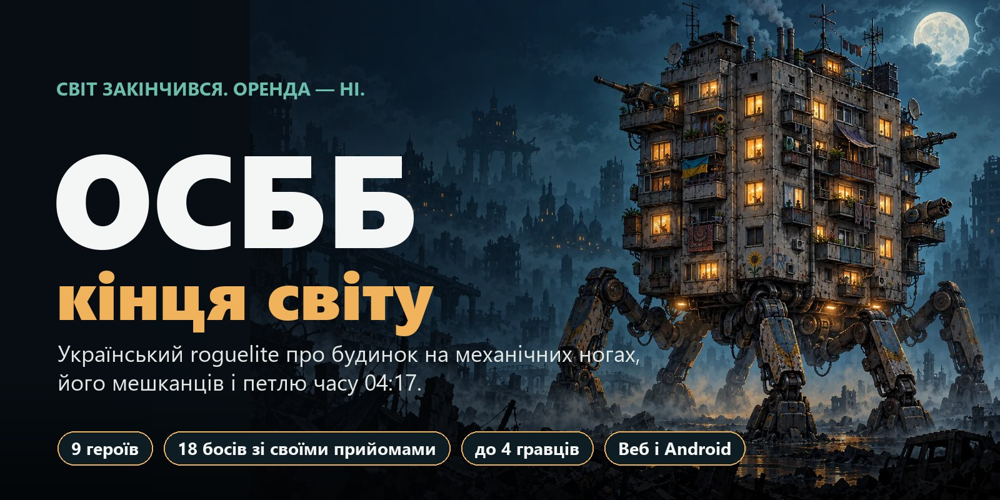
</h1>

<p align="center">
  <a href="https://valera99686.github.io/osbb-end-of-world/"></a>
  <a href="https://github.com/valera99686/osbb-end-of-world/releases/latest"></a>
</p>

<p align="center">
  <a href="https://github.com/valera99686/osbb-end-of-world/actions/workflows/ci.yml"></a>
  <a href="https://github.com/valera99686/osbb-end-of-world/releases/latest"></a>
  
  
  
</p>

<p align="center">
  <a href="#швидкий-старт">Швидкий старт</a> ·
  <a href="docs/game-description.md">Опис гри</a> ·
  <a href="docs/guide/osbb-putivnyk-gravtsya.pdf">Путівник</a> ·
  <a href="docs/leaders.md">Боси</a> ·
  <a href="docs/architecture.md">Архітектура</a> ·
  <a href="CHANGELOG.md">Зміни</a>
</p>

Український 2D roguelite у світі 2086 року: механічний будинок №17 на ногах, мешканці та їхні квартири, бойові модулі, автоматичний вогонь, ривки, розгалужені експедиції, сюжет із чотирма кінцівками й озвучкою. Грати можна самому, вдвох на одному екрані або **до чотирьох по мережі** з чатом і голосом. Працює в браузері (і без мережі після першого відкриття) та як Android-застосунок. Немає реклами, облікових записів і телеметрії.

## Чим вона цікава

- **Будинок як зброя.** Ти не цілишся: будинок стріляє сам, а ти обираєш місце, ривком виходиш із позначених зон і ставиш у квартири сусідів, які дають бонуси. Правильний сусід вмикає еволюцію зброї.
- **Кожен бос і мінібос із власним прийомом.** Броня спереду, антени, що захищають, кокони, що лікують, потоп і клапан, яйця, креслення підлоги, дроти, зупинка часу... 18 різних механік, у босів ще фаза «Лють» ([докладно](docs/leaders.md)).
- **До чотирьох гравців.** Кожен у своєму будинку й зі своїми перками, один бос на всіх; вилетів — зайдеш у ту саму гру. Збори ОСББ між локаціями, спільні події з ролями, голос.
- **Велика кампанія.** 3 локації, дев'ять героїв, 110 предметів і 51 меблі (частина з мінусом за сильніший плюс), 28 перків, сюжет «Справа 04:17» із чотирма кінцівками й 650 озвученими репліками.
- **Чесно виміряно.** Баланс, тривалість гри й кооператив перевіряють боти справжнім кодом гри ([фінмодель](docs/finmodel.md), [прогони](docs/balance/)).

## Скриншоти

<table>
  <tr>
    <td width="50%">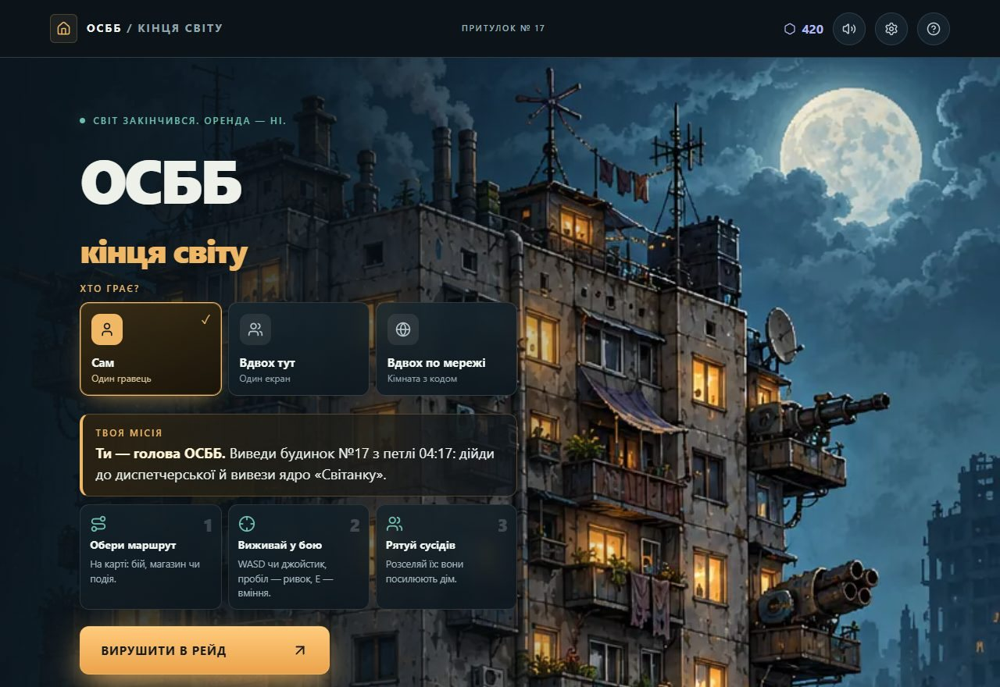<br><sub>Притулок: хто грає, мета, вихід у рейд</sub></td>
    <td width="50%">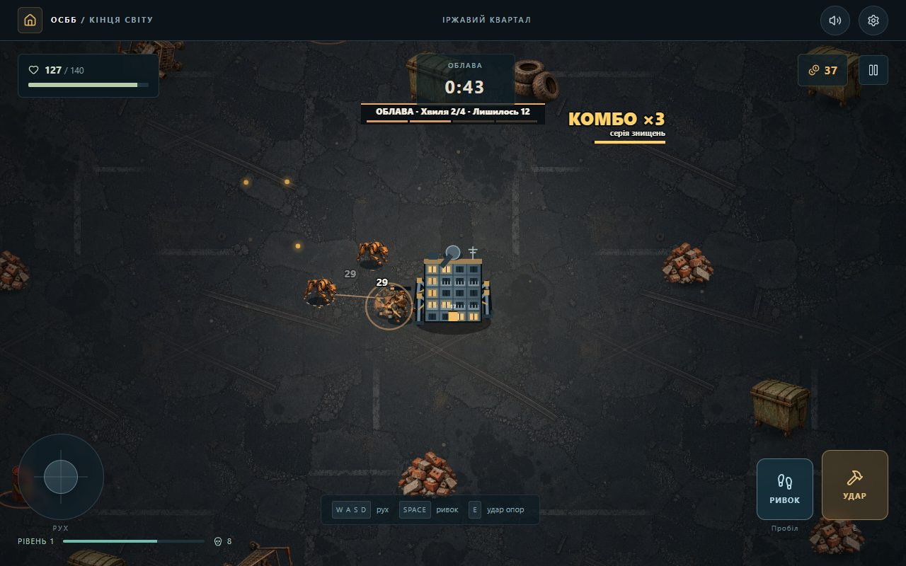<br><sub>Бій: будинок стріляє сам, ти обираєш місце</sub></td>
  </tr>
  <tr>
    <td>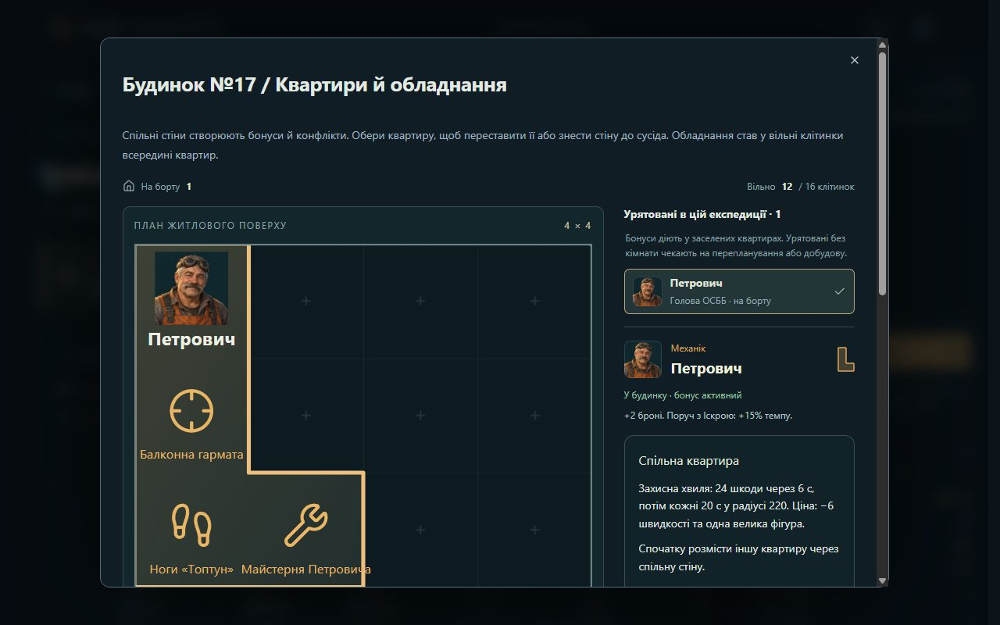<br><sub>План будинку: квартири, мешканці, обладнання, меблі</sub></td>
    <td>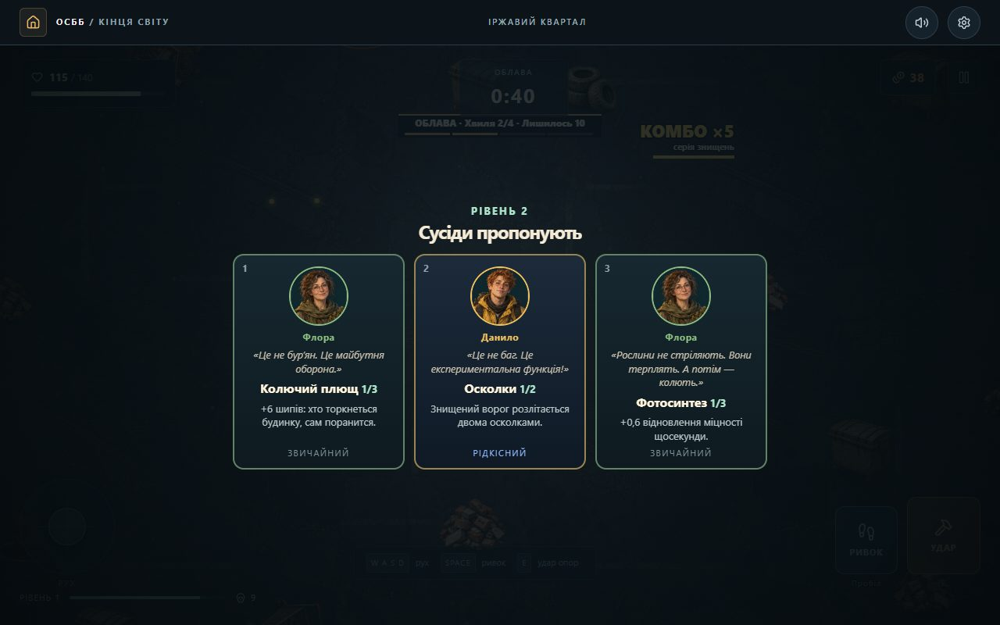<br><sub>На кожному рівні сусіди пропонують по перку</sub></td>
  </tr>
  <tr>
    <td>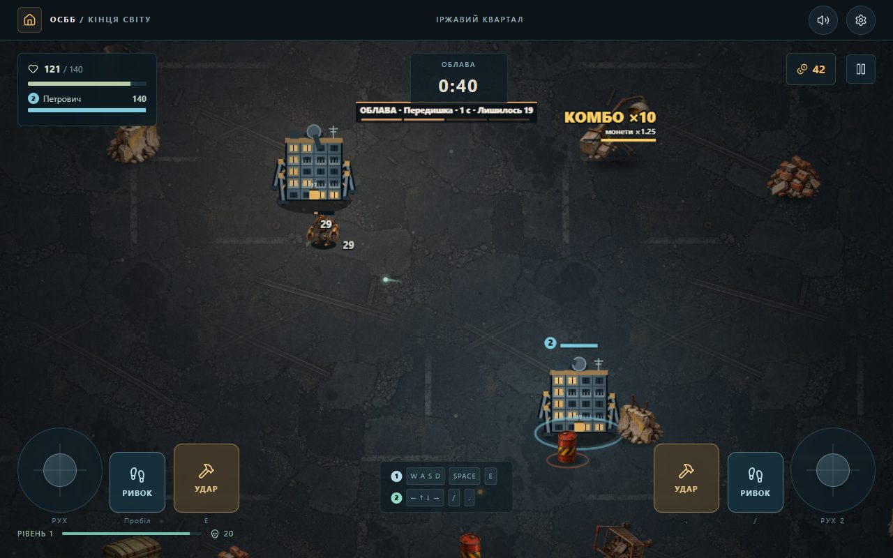<br><sub>Вдвох на одному екрані</sub></td>
    <td>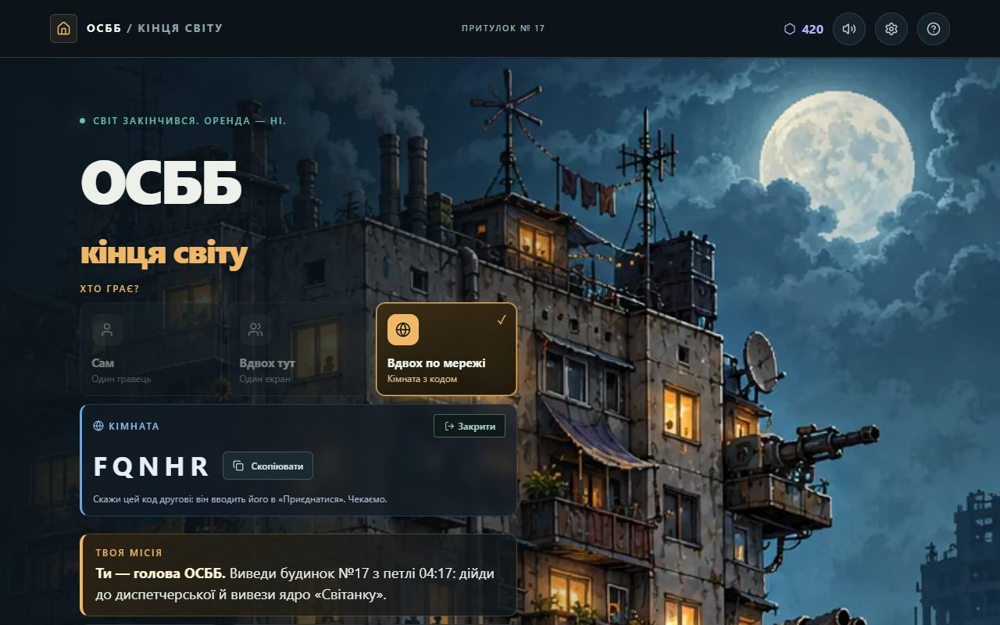<br><sub>Кімната по мережі: код із п'яти символів</sub></td>
  </tr>
</table>

### Боси зі своїми прийомами

<table>
  <tr>
    <td width="25%">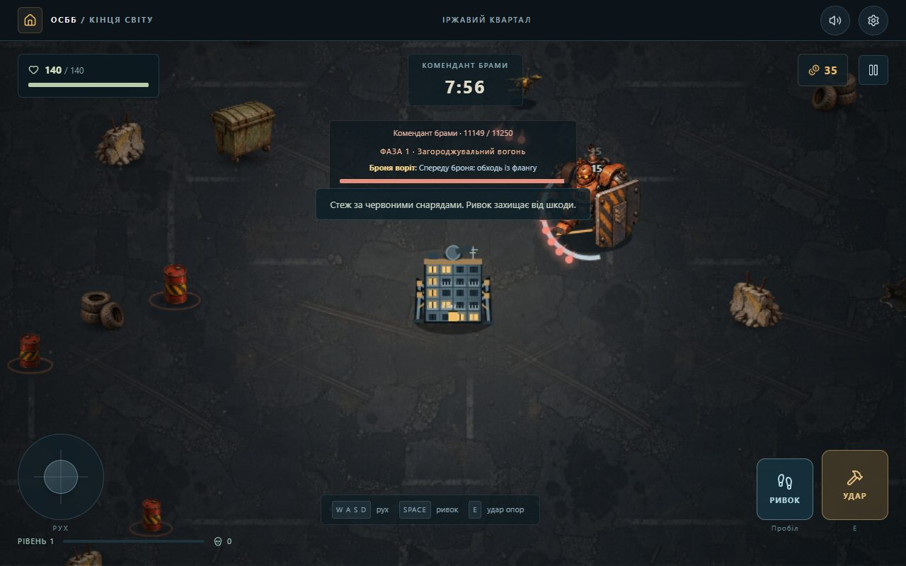<br><sub><b>Комендант:</b> броня спереду, обходь із флангу</sub></td>
    <td width="25%">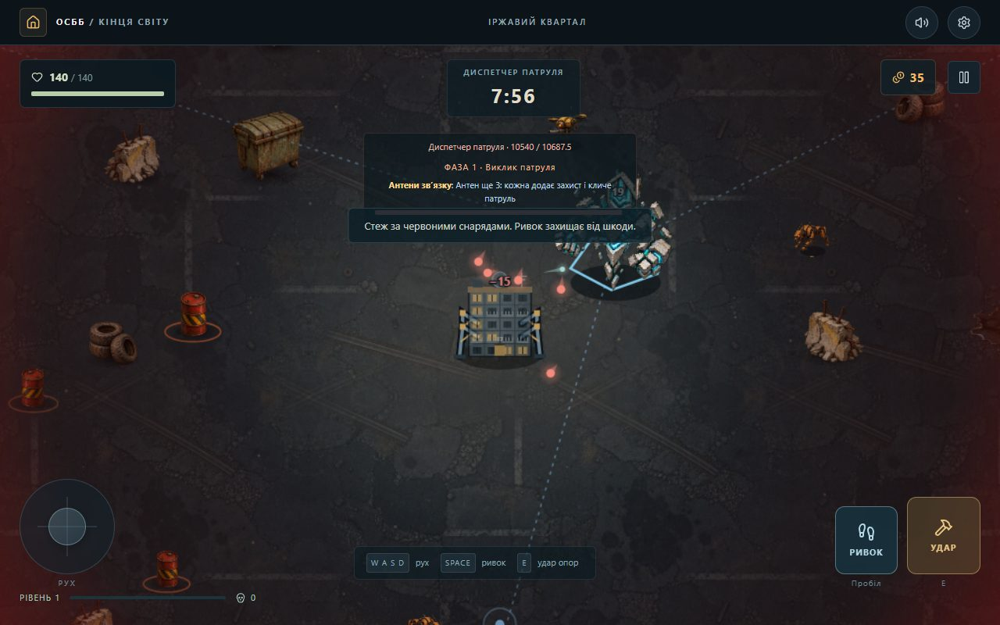<br><sub><b>Диспетчер:</b> антени дають захист і кличуть патруль</sub></td>
    <td width="25%">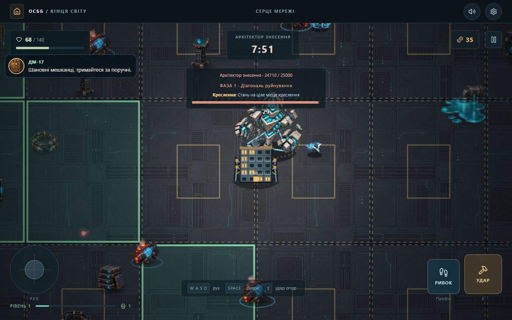<br><sub><b>Архітектор:</b> стань на цілу клітину креслення</sub></td>
    <td width="25%">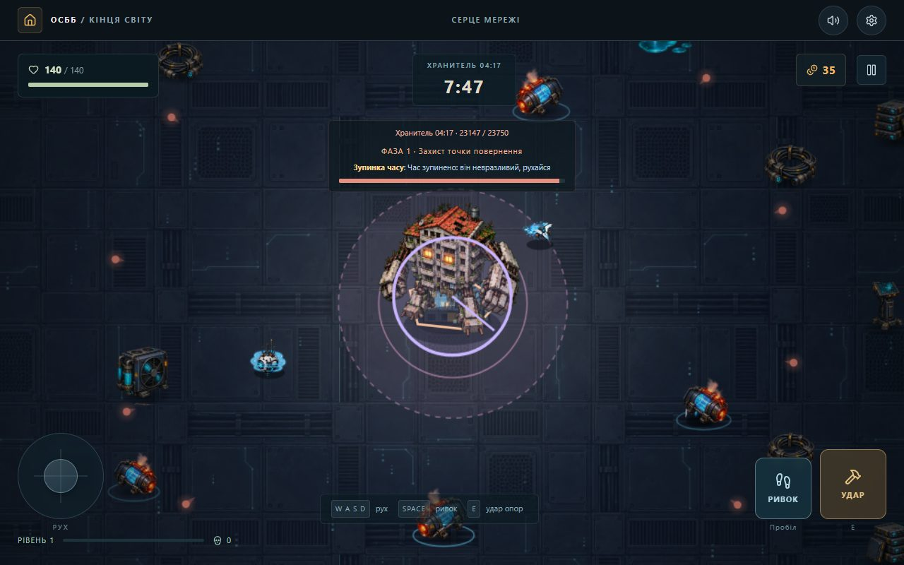<br><sub><b>Хранитель:</b> зупиняє час і шле відлуння</sub></td>
  </tr>
</table>

## Грати

Онлайн: **https://valera99686.github.io/osbb-end-of-world/** (працює й офлайн після першого відкриття; мережа потрібна лише для гри по мережі). Android APK завантажується з розділу [Releases](https://github.com/valera99686/osbb-end-of-world/releases) цього репозиторію.

### Швидкий старт

Потрібен Node.js 22.13 або новіший. З чистого клону:

```
git clone https://github.com/valera99686/osbb-end-of-world.git
cd osbb-end-of-world
npm ci
npm run dev        # http://127.0.0.1:5173
npm test           # усі тести, кілька секунд
npm run build      # статична збірка в build/
```

APK збирається окремо (потрібні JDK 21 і Android SDK, див. «Збірку» нижче); для гри й перевірок вони не потрібні.

### Керування

Клавіші WASD або стрілки — рух, Space — ривок, E — вміння героя (у кожного з дев’яти голів ОСББ своє), P або Escape — пауза. На сенсорному екрані джойстик з’являється там, де палець торкнувся арени (є й постійний у кутку), і дві кнопки. Геймпад: лівий стік або хрестовина — рух, A або RT — ривок, B або RB — вміння, Start — пауза; у меню стік і хрестовина переміщують фокус, A натискає, B повертає назад.

### Режими гри

У Притулку блок «Хто грає?»:

- **Сам.** Звичайна гра.
- **Вдвох тут.** Один екран і два будинки: другий гравець на стрілках (`/` — ривок, `.` — вміння), другому геймпаді або другому джойстику. Не потребує мережі. Правила й числа: [docs/coop.md](docs/coop.md).
- **По мережі (до 4 гравців).** Господар створює кімнату з кодом із п’яти символів, до трьох друзів вводять його. Працює між ПК і телефонами, потрібні інтернет і однакова версія гри. У кожного свій будинок і свій ряд нагороди, куди йти по карті, вирішують вдвох, є текстовий і голосовий чат. Коли пряме з’єднання не виходить, гра сама переходить на резервний канал. Опис, протокол і обмеження: [docs/online.md](docs/online.md).

## Документація

| Що | Де |
| --- | --- |
| Опис гри для того, хто її не бачив: концепт, механіка, правила, герої, ціни | [docs/game-description.md](docs/game-description.md) |
| Путівник гравця (PDF, понад 20 скріншотів з живої гри) | [docs/guide/osbb-putivnyk-gravtsya.pdf](docs/guide/osbb-putivnyk-gravtsya.pdf) |
| Презентація (19 слайдів з нотатками), сценарій демо, відповіді на питання | [docs/presentation/](docs/presentation/) |
| Фінмодель: скільки триває гра, монетизація (пропозиція), ринок і дохід | [docs/finmodel.md](docs/finmodel.md) |
| Архітектура, збереження, озвучка, як додати ворога чи перк | [docs/architecture.md](docs/architecture.md) |
| Гра по мережі, чат і голос | [docs/online.md](docs/online.md) |
| Локальний кооператив і числа балансу | [docs/coop.md](docs/coop.md), [docs/balance/](docs/balance/) |
| План робіт, віхи, ризики | [docs/wbs/README.md](docs/wbs/README.md), [docs/ROADMAP.md](docs/ROADMAP.md) |
| Перевірки перед релізом, доступність, плейтест, телефон і швидкодія | [docs/qa](docs/qa/), [docs/qa/android.md](docs/qa/android.md) |
| Усі зміни по версіях | [CHANGELOG.md](CHANGELOG.md) |

## Що є в грі (0.43.0)

### Кампанія та бій

- 3 локації підряд: Іржавий квартал, Зелені куполи, Серце мережі. Мета сюжету — вийти з петлі 04:17: дійти до диспетчерської й вивезти ядро «Світанку», щоб годинник пішов далі (04:18).
- Карта кожної локації — випадкове дерево на 10 кроків: 38–49 кімнат, 3–6 вузлів у ряду, розвилки й злиття шляхів, бос наприкінці. Кімнати: бій, еліта, мінібос, подія, скриня, магазин, перепочинок і випадкова «?».
- Бій: автоматичний вогонь, ривок, вміння героя на E, 12 іменованих загонів із трьох хвиль і ватажка, 18 типів ворогів (по 6 на локацію), 9 мінібосів і 9 босів (по 3 на локацію), у кожного свій прийом ([docs/leaders.md](docs/leaders.md): броня, антени, кокони, потоп, креслення, зупинка часу...), у босів ще й фаза «Лють», небезпечні зони, що позначаються до удару, тверді предмети на арені, комбо, події посеред бою.
- Вибір у рейді: 28 перків при підвищенні рівня (три сусіди пропонують по одному), 7 ядер зброї з 7 еволюціями, 36 подій кампанії з вибором плюс 6 спільних для двох гравців.
- Заставка боса й мінібоса з портретом, порадою «як перемогти» і словами боса.
- Навчання першого рейду з 5 кроків; його можна пропустити й пройти знову через довідку.

### Будинок і прогрес

- 110 предметів: 103 модулі чотирьох сімейств (механіка, електрика, органіка, прокляття) і 7 ядер зброї; чотири рідкості. У 39 модулів сильний плюс іде разом із мінусом (наприклад, «+60% темпу стрільби, −30 міцності, −1 броні»), мінус на картці червоний. Модулі стоять у 22 гніздах обладнання в квартирах; склад на 30 запасних модулів, безпечна заміна й розбирання.
- 9 мешканців із портретами та фігурними квартирами. План будинку 4×4 під час рейду розширюється до 5×4, 5×5 і 6×6 за 200 / 360 / 520 монет. Повороти, перетягування (мишею й пальцем: квартири, мешканці, модулі й меблі з лотка під планом, без гортання), комбінації сусідства, об’єднання квартир. 51 предмет меблів (15 із мінусом); улюблені меблі мешканця дають подвійний плюс, знайдені чи куплені меблі можна поставити одразу, як і модуль.
- 9 голів ОСББ: Петрович відкритий з початку, решта після 1, 2, … 8 повних експедицій. У кожного своє вміння на E, особистий бонус, стартовий предмет і епілог.
- Кожна експедиція, навіть програна, приносить ядра. Майстерня: 26 креслень (16 модулів, 10 меблів) за віхи й 6 модифікаторів рейду. Кодекс, журнал, 48 досягнень, статистика, «Наступна ціль».
- Складність 0–10, денний забіг (рекорд ставить перша спроба дня), нескінченна експедиція, посилені вороги з шістьма властивостями.
- Локальне збереження з контрольною точкою перед боєм, код збереження `OSBB1:…` для переносу між пристроями.

### Сюжет і звук

- Сюжет «Справа 04:17»: діалоги з портретами, 12 доказів, чотири кінцівки (Протокол № 18, Позачергові збори, 04:16, Загальні збори), 28 сюжетних сцен, 31 сцена Притулку, дошка оголошень, секретні досягнення.
- Усі 650 реплік озвучено (Eleven v4, кожен запис перевірено розпізнаванням мовлення); музика синтезується Web Audio (4 теми по 3 шари), 18 звукових ефектів.

### Гра вдвох

- На одному екрані: другий будинок, піднімання впалого, удвічі більше ворогів і двоє ватажків.
- По мережі: кімната за кодом через PeerJS і WebRTC, автоматичний резервний канал через публічні MQTT-брокери, два способи ділити бій («Обидва рахують» і «Хост рахує»), власний будинок гостя й два ряди нагороди, голосування за маршрут, чат із 10 швидкими фразами, голосовий чат (на резервному каналі як «рація»).

### Доступність

- Розмір тексту 100 / 115 / 130%, «менше спалахів», тряска екрана 0 / 50 / 100%, вібрація, числа шкоди.
- Фільтр кольорів на весь екран для протанопії, дейтеранопії й тританопії (окремий перемикач змінює палітру снарядів у бою).
- Клавіатура, дотик, геймпад у бою й меню.

## Версії в двох словах

| Версія | Що додано |
| --- | --- |
| 0.10 | налаштування, статистика, денний забіг, нескінченний режим, загроза, музика, геймпад, PWA |
| 0.11–0.13 | сюжет «Справа 04:17» і озвучка, 28 перків, ядра зброї з еволюціями, вміння героїв, заставки босів |
| 0.14–0.16 | ще п’ять голів, тверді предмети, балконна ракетниця, епілоги, дошка оголошень, секретні досягнення |
| 0.17–0.21 | кооператив на одному екрані, гра по мережі, резервний канал, один бій на двох і голосування, гість грає за другий будинок |
| 0.22–0.24 | два пули предметів, власний будинок гостя, простіше меню |
| 0.25–0.31 | спільні події, більше подій із втратами, мета сюжету, складніший бій |
| 0.32–0.34 | боси й мешканці з обличчями, голоси Eleven v4 на всі 650 реплік |
| 0.35–0.37 | текстовий і голосовий чат, голос «рацією» через резервний канал, фільтр кольорів на весь екран |
| 0.38 | гра на телефоні: плаваючий джойстик, перетягування пальцем, компактні рація й смуга боса |
| 0.39 | у кооперативі кожен обирає перк для свого будинку, ядра за рейд порівну, меблі в ряду гостя, гість бачить нові для себе сцени; гра по мережі більше не зависає після вибору перка |
| 0.42 | боси й мінібоси не звичайні: у кожного з 18 свій прийом (броня, антени, кокони, потоп і клапан, яйця, креслення, дроти, зупинка часу; магніт, пара, мітки, охорона, камуфляж, двійники, «Двічі»), боси важчі: фаза «Лють» і швидший темп; протокол 9 |
| 0.41 | до чотирьох гравців по мережі, один лідер на всіх, спільні події на чотири ролі, збори ОСББ між локаціями (і в одиночній грі), повернення в ту саму гру після вильоту, голос усім |
| 0.40 | фінмодель (тривалість гри ботами, монетизація як пропозиція, ринок), бій вимагає руху, сцени Притулку для гостя, плавніший бій на слабких телефонах і лічильник кадрів, бій розбито на три файли; 0.40.1 — демо-магазин і демо-кнопки запропонованих покупок (оплати немає) |

Докладно: [CHANGELOG.md](CHANGELOG.md).

## План робіт

Проєкт бере участь у «Конкурсі проєктів 2026». Структура робіт (епіки, задачі, DoD, оцінки в годинах, дедлайн розробки 30.11.2026) лежить у [docs/wbs/README.md](docs/wbs/README.md); [wbs.csv](docs/wbs/wbs.csv) повторює колонки шаблону конкурсу. Календар на 19 жовтня – 15 грудня, віхи й ризики — у [docs/ROADMAP.md](docs/ROADMAP.md). Статуси задач ведуться на дошці GitHub Projects; файли в репозиторії це знімок плану.

## Збірка

`npm run build` — статична вебверсія в `build/`. `npm test` — інваріанти економіки, прогресії, збережень, режимів і досягнень, мережевий протокол, чат, голосовий кодек, колірні матриці, аудіо без браузера та симуляція боїв. `npm run typecheck` — TypeScript. `npm run lint` — oxlint. Список модулів і тестів у `scripts/test.mjs` задано явно; новий файл у `lib/game/` або `tests/` без запису в ньому зупиняє `npm test`.

Для GitHub Pages: `npm run build:pages` збирає версію під підшлях `/osbb-end-of-world/` у `.pages/` (шляхи ресурсів і офлайн-кеш враховують базу, APK завантажується з останнього релізу), `npm run deploy:pages` публікує її однією свіжою комітною гілкою `gh-pages`. Базу для власної збірки задають змінні `OSBB_BASE`, `OSBB_OUT`, `OSBB_APK_URL`.

Для Android встановіть JDK 21 і Android SDK `platforms;android-36`, `build-tools;36.0.0`. Спершу `npm run build` (скрипт APK сам вебзбірку не робить), потім `npm run build:android` або `powershell -ExecutionPolicy Bypass -File scripts/build-android.ps1 -SdkPath PATH -JdkPath PATH`. За замовчуванням використовується локальний `.tools/android-sdk`. Скрипт створює перевірений, підписаний тестовим ключем `releases/osbb.apk` без Gradle й звіряє файли гри в APK із вебзбіркою. Браузерні ресурси вбудовані в APK. **Дозволи:** `INTERNET` і `ACCESS_NETWORK_STATE` (лише для гри по мережі), `RECORD_AUDIO` і `MODIFY_AUDIO_SETTINGS` (голосовий чат, мікрофон вмикається лише коли гравець сам натисне кнопку), `VIBRATE`. Одиночна гра й гра вдвох на одному екрані мережі не потребують. Ключ зберігається тільки в ігнорованій `.localkeys`.

Це інсталяційна тестова збірка. Публікація в Google Play окрема: потрібні власний захищений upload key, Android App Bundle, анкета контенту, сторінка конфіденційності й перевірка на реальному пристрої. Жодних гарантій схвалення магазину не заявляється.

## Перевірки

- `npm test` (460 тестів, близько 10 с), `npm run typecheck`, `npm run lint` (помилок немає; лишилося 56 попереджень про залежності ефектів React). CI на кожен push робить типи, тести й збірку.
- `scripts/balance-audit.cjs` і `scripts/coop-bench.cjs` — баланс бою й кооперативу.
- `scripts/net-e2e.cjs` — два справжніх Chrome через публічний брокер: бій, голосування, події, чат, голос, резервний канал.
- `scripts/party-e2e.cjs` — три й чотири справжніх Chrome: бій у lockstep (зокрема з босом, `FIGHT=boss LEADER=0:2`), повернення після вильоту, збори ОСББ, голос; відбитки стану всіх гравців збігаються.
- `scripts/qa/mobile.cjs` — телефон в емуляції, 390 × 844 і 844 × 390: сцени, карта, перетягування пальцем, бій і джойстик, перки, бої з босами (рядок із прийомом вміщається в екран), збори ОСББ; 36 кроків без помилок.
- `scripts/qa/perf.cjs` — швидкодія на «слабкому телефоні» (процесор уповільнено в 4 рази): звичайний бій 34 кадри/с, боси з прийомами 50–69; `LEADER=розділ:варіант` міряє бій із босом. Таблиця — у [docs/qa/android.md](docs/qa/android.md).
- `scripts/playtime.cjs` — бот-кар'єра з нового профілю: скільки годин триває гра ([фінмодель](docs/finmodel.md)).
- `scripts/qa/screens.cjs` — знімки екрана з живої гри для путівника; `scripts/qa/build-deck.cjs` — слайди.
- **Чесно:** APK з дозволом мікрофона, голос через справжній мікрофон, колірні фільтри й швидкодію на справжньому слабкому телефоні (лише емуляція) не перевірено; живих плейтестів було кілька.

## Архітектура

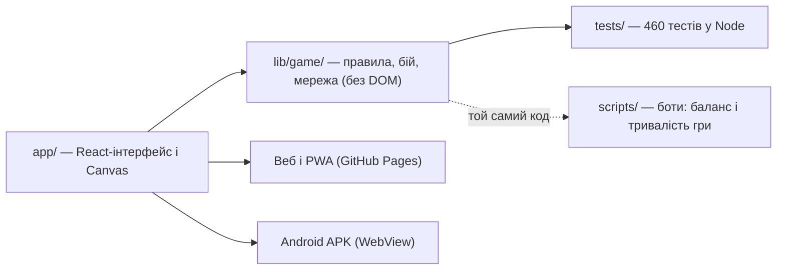

Гра по мережі: **зірка**. Гості говорять лише з господарем, він пересилає решті; бій ділиться двома способами (усі рахують один бій у lockstep або господар рахує, а гості бачать «дзеркало»).

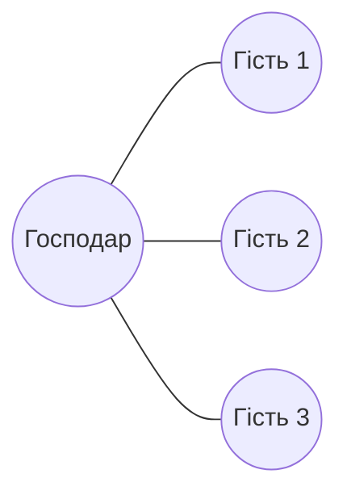


Повний опис шарів, збереження, озвучки, мережі й рецептів «як додати ворога, перк, досягнення» — у [docs/architecture.md](docs/architecture.md). Коротко:

`lib/game/` (без DOM, компілюється в Node для тестів):

- `data.ts` — модулі, герої, дослідження; `encounters.ts` — локації, вороги, боси; `bosses.ts`, `minibosses.ts` — атаки й небезпечні зони.
- `model.ts` — економіка, маршрути, прогрес, другий будинок гостя (`mateRun`), кінець рейду; `save.ts` — завантаження, міграції, код збереження; `profile.ts` — резервна копія, імпорт і скидання.
- `modes.ts` — денний забіг, складність, посилені вороги, комбо, події в бою; `achievements.ts`; `progression.ts` — віхи, креслення, модифікатори, «Наступна ціль».
- `residents.ts`, `apartments.ts`, `furniture.ts`, `equipment.ts`, `backpack.ts`, `specials.ts` — будинок, квартири, меблі, обладнання.
- `story.ts` — діалоги, 12 доказів, кінцівки, репліки; `barks.ts`, `campaign-content.ts`, `cutscenes.ts`, `lore.ts`, `notices.ts`.
- `upgrades.ts` — перки; `weapons.ts` — ядра й еволюції; `heroes.ts` — вміння героїв.
- `engine.ts` — Canvas-бій (клас `Battle`: симуляція), `battle-view.ts` — його малювання, `battle-core.ts` — типи й константи бою; `arena.ts`, `enemy-art.ts`, `sprites.ts`, `pace.ts`; `audio.ts` — синтезована музика й ефекти.
- Мережа: `net.ts` (протокол, `Lockstep`), `session.ts` (`NetSession`), `mirror.ts` (знімки бою), `mqtt.ts`, `chat.ts`, `vox.ts` (кодек «рації»), `coop.ts` (числа й нагороди), `cvd.ts` (колірні фільтри).

`app/` — React-інтерфейс: `game.tsx` (екрани й профіль), `combat.tsx` (бій, вантажиться окремо), `online.tsx`, `guest-home.tsx`, `chat-dock.tsx`, `voice-chat.ts`, `net-peer.ts`, `relay-link.ts`, `settings.tsx`, `cvd-filters.tsx` та інші. `android/` — Java-оболонка з локальним HTTPS-origin; політика конфіденційності: `public/privacy.html`.

Немає реклами, облікових записів, реальних платежів або телеметрії. Збереження не синхронізуються між вебом і APK автоматично; вони незалежні на кожному пристрої та origin. Перенести прогрес можна кодом збереження з налаштувань.

## Джерела

Артілюстрацію головного екрана та атласи ворогів згенеровано OpenAI ImageGen для цього проєкту. Підлоги й декорації арен (`floor-*`, `props-*`) та атлас ворогів Серця мережі (`enemies-core-v2`) згенеровано вбудованим генератором зображень Codex CLI; промпти лежать у `docs/art-prompts/v3-arena-prompts.json`, вихідні PNG — у `docs/art-source/`. Фони сцен Притулку після поразки (`shelter-*`) згенеровано GPT Image 2 через mage.space (промпти в `docs/art-prompts/shelter-prompts.json`). Портрети Галини Степанівни й домофона згенеровано Codex CLI, портрет Світанку й ілюстрації кінцівок — GPT Image 2.5 Flare (mage.space); промпти — `docs/art-prompts/v4-story-portraits.json`. Портрети дев’яти босів і дев’яти мінібосів — GPT Image 2.5 Flare, промпти в `docs/art-prompts/v5-boss-portraits.json` і `v6-miniboss-portraits.json`. Ігрові зображення зберігаються у WebP. Зелений фон на атласах ворогів декодер Canvas прибирає один раз перед кешуванням спрайтів.

Озвучка: 650 реплік записано моделлю Eleven v4 (раніше локальною OmniVoice; конвеєр і перегенерація описані в `scripts/voice/README.md`). Музика й ефекти синтезуються в самій грі. Іконки Lucide: ISC. Бібліотеки мають власні ліцензії. Ігрові об’єкти малюються Canvas.
