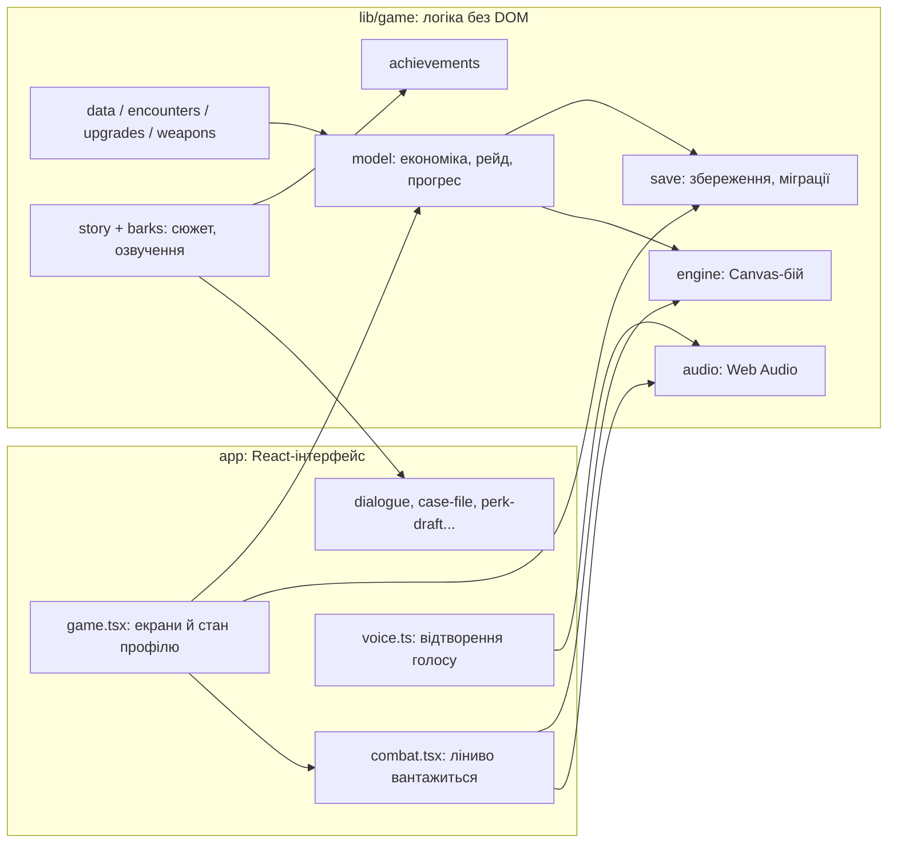

# Архітектура

Одна статична кодова база дає три збірки: веб-версію (`build/`), версію для GitHub Pages (`.pages/`) і офлайн-APK (`releases/osbb.apk`). Сервера немає: профіль гравця лежить у `localStorage` (веб) або в сховищі WebView (APK).

## Шари

- **`lib/game/`** не знає про DOM: його модулі компілюються в Node (`scripts/test.mjs`) і перевіряються без браузера. Винятки вузькі й захищені (`typeof Image`, `typeof document`).
- **`app/`** тримає екрани й профіль (`Meta`) у `game.tsx`; бій винесено в `combat.tsx` і вантажиться окремим чанком разом з `engine.ts`.
- **`engine.ts`** — Canvas-бій на фіксованому кроці симуляції; рендер не споживає генератор випадкових чисел бою, тож повтор із тим самим зерном дає той самий результат.
- **`audio.ts`** — уся музика й ефекти синтезуються Web Audio; файлів музики в збірці немає. Голос (`app/voice.ts`) грає окремі `.ogg`, а `AudioEngine.setSpeaking` стишує музику.

## Збереження

`model.ts` описує `Meta` (профіль: валюта, відкриття, досягнення, докази, кінцівки, налаштування) і `Run` (поточна експедиція). `save.ts` читає `localStorage['osbb.save.v1']` через `readSave`: кожне поле проходить санітизацію й міграцію, пошкоджений або старий запис не ламає гру (`error`, `refund`). `saveData` пише назад. Сюжет має `STORY_REVISION` (`cutscenes.ts`): коли сюжет переписано, старі профілі бачать новий пролог один раз. Код збереження `OSBB1:` (`save.ts`) переносить профіль між пристроями; `profile.ts` — резервна копія, імпорт і скидання.

## Сюжет і озвучка

- `story.ts`: сцени (`SCENES`), події Притулку між рейдами (`HUB_BEATS`, `AFTER_ENDING`), 12 доказів (`CLUES`), три кінцівки (`ENDINGS`), репліки в бою (`BARKS`) і слова босів (`BOSS_TAUNTS`).
- Кожна репліка озвучена: файл `public/voice/<id>.ogg`, де `id` = хеш пари (голос, текст) з `voice.ts`. `voice-manifest.ts` (генерується) перелічує наявні файли; гра відтворює лише ті, що є. Репліки з номером спроби записано для 1–8 (`VOICED_NUMBERS`).
- Генерація й емоції: `scripts/voice/README.md`.

## Збірки

| Команда | Результат |
| --- | --- |
| `npm run dev` | dev-сервер Vite на 5173 |
| `npm run build` | `build/`: корінь `/`, service worker для офлайну |
| `npm run build:pages` / `deploy:pages` | `.pages/` під `/osbb-end-of-world/` і гілка `gh-pages` |
| `npm run build:android` | `releases/osbb.apk`, без Gradle (розмір скрипт не обмежує) |

Базовий шлях передається змінною `OSBB_BASE`; у коді всі ресурси йдуть через `asset('art/…')` з `lib/game/assets.ts`, а `tests/assets.test.cjs` забороняє жорстко прописані `/art`, `/voice`.

## Перевірки

`npm test` збирає потрібні модулі в `.test-build/` і запускає `node --test`. Списки модулів і тестів у `scripts/test.mjs` явні: новий файл у `lib/game/` або `tests/` без запису зупиняє `npm test`. `scripts/balance-audit.cjs` гонить контрольовані бої й перевіряє шість умов відчуття бою. CI (`.github/workflows/ci.yml`) виконує типи, тести й збірку на кожен push.

## Як додати

**Ворога.** Запис у `ENEMY_DEFS` (`encounters.ts`), клітинка в атласі `public/art/enemies-*.webp`, тип у списку ворогів потрібної локації (`LOCATIONS`). `npm test` покаже, чи сходиться баланс.

**Перк.** Запис у `PERKS` (`upgrades.ts`) і його ефект у `engine.ts` (метод `pk(id)` повертає рівень перка в поточному рейді). Репліки мешканців при пропозиції — `OFFER` у `barks.ts`; після зміни текстів перезапусти озвучку.

**Ядро зброї.** Предмет `core_*` у `data.ts`, поведінка пострілу в `weapons.ts` і `fireCore` в `engine.ts`; еволюція — запис у `EVOLUTIONS`.

**Досягнення.** Запис у `DEFINITIONS` (`achievements.ts`) з перевіркою від `Meta`, назва іконки Lucide додається в `ICONS` у `app/records.tsx` (тест стежить, щоб іконка існувала).

**Сцену чи репліку.** Рядок у `story.ts` (`L('галина', 'текст')`); потім `npm test`, `node scripts/voice/export-lines.cjs scripts/voice/lines.json` і `generate.py` (див. README озвучки). Тест сам скаже, якщо репліка без запису.

**Малюнок.** PNG-джерело в `docs/art-source/`, `webp` у `public/art/` (портрет боса ≤ 60 КБ), промпт у `docs/art-prompts/`. Ліміту на розмір APK немає; розмір видно у виводі `npm run build:android`.
