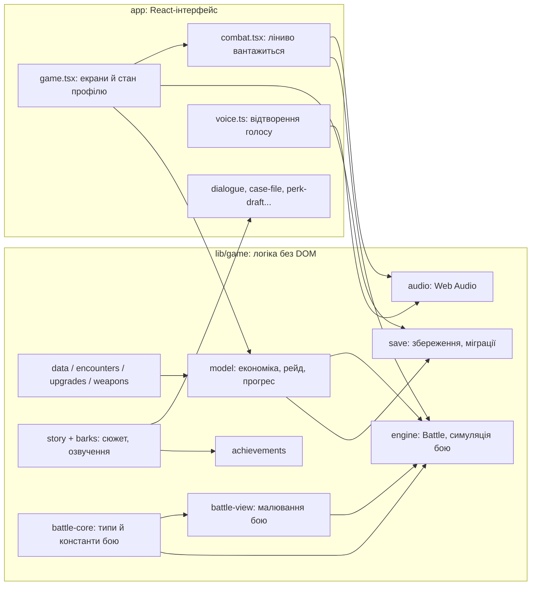
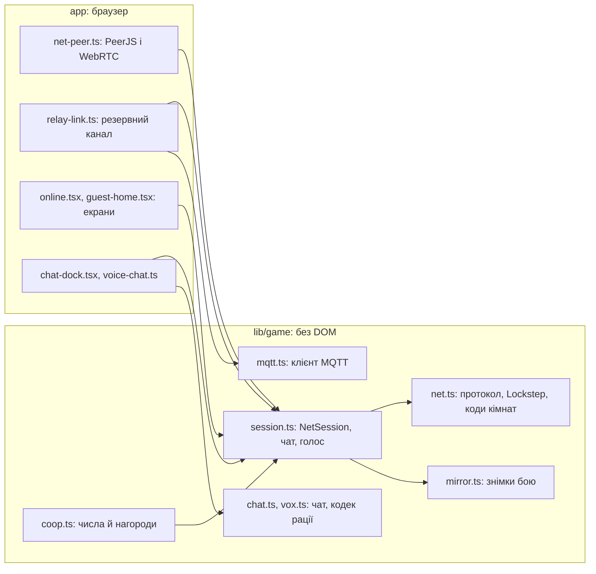

# Архітектура

Одна статична кодова база дає три збірки: веб-версію (`build/`), версію для GitHub Pages (`.pages/`) і офлайн-APK (`releases/osbb.apk`). Сервера немає: профіль гравця лежить у `localStorage` (веб) або в сховищі WebView (APK).

## Шари

- **`lib/game/`** не знає про DOM: його модулі компілюються в Node (`scripts/test.mjs`) і перевіряються без браузера. Винятки вузькі й захищені (`typeof Image`, `typeof document`).
- **`app/`** тримає екрани й профіль (`Meta`) у `game.tsx`; бій винесено в `combat.tsx` і вантажиться окремим чанком разом з `engine.ts`.
- **Бій** — три файли. `engine.ts` (клас `Battle`) крокує симуляцію з фіксованим кроком: рух, постріли, шкода, перки, напарник, lockstep. `battle-view.ts` малює її на Canvas і нічого в ній не змінює; рендер не споживає генератор випадкових чисел бою, тож повтор із тим самим зерном дає той самий результат. `battle-core.ts` — спільний словник обох: типи ворогів, куль, частинок, HUD, константи бою й дрібні помічники малювання. Як вони з’єднані, див. «Патерни» нижче.
- **`audio.ts`** — уся музика й ефекти синтезуються Web Audio; файлів музики в збірці немає. Голос (`app/voice.ts`) грає окремі `.ogg`, а `AudioEngine.setSpeaking` стишує музику.

## Збереження

`model.ts` описує `Meta` (профіль: валюта, відкриття, досягнення, докази, кінцівки, налаштування) і `Run` (поточна експедиція). `save.ts` читає `localStorage['osbb.save.v1']` через `readSave`: кожне поле проходить санітизацію й міграцію, пошкоджений або старий запис не ламає гру (`error`, `refund`). `saveData` пише назад. Сюжет має `STORY_REVISION` (`cutscenes.ts`): коли сюжет переписано, старі профілі бачать новий пролог один раз. Код збереження `OSBB1:` (`save.ts`) переносить профіль між пристроями; `profile.ts` — резервна копія, імпорт і скидання.

## Сюжет і озвучка

- `story.ts`: сцени (`SCENES`), події Притулку між рейдами (`HUB_BEATS`, `AFTER_ENDING`), 12 доказів (`CLUES`), три кінцівки (`ENDINGS`), репліки в бою (`BARKS`) і слова босів (`BOSS_TAUNTS`).
- Кожна репліка озвучена: файл `public/voice/<id>.ogg`, де `id` = хеш пари (голос, текст) з `voice.ts`. `voice-manifest.ts` (генерується) перелічує наявні файли; гра відтворює лише ті, що є. Репліки з номером спроби записано для 1–8 (`VOICED_NUMBERS`).
- Генерація й емоції: `scripts/voice/README.md`.

## Бій: герої, арена, денний забіг

**Герої.** `CHARACTERS` у `data.ts`: дев’ять голів, відкриваються перемогами (`win`), мають стартовий предмет (`start`) і особисті бонуси в `statsFor` (`model.ts`). Вміння на E: числа й тексти в `heroes.ts`, поведінка в методах `ability*` класу `Battle` (`engine.ts`). У малій квартирі слотів менше, тому стартовий набір (гармата, ноги, власний предмет) частково лягає в рюкзак.

**Тверді предмети.** Усе, що стоїть на арені, крім вибухових бочок і плоских калюж, зупиняє будинок і ходячих ворогів і поглинає ворожі снаряди. Колізія — ряд кіл уздовж основи картинки (`solidCircles` за таблицею `FOOT` у `arena.ts`: ліва й права межа, низ і глибина основи в частках картинки, виміряні на атласах), тож широкий смітник такий самий широкий, як виглядає, а коло не виходить нижче за картинку. Розкладку, яку дає сід, вони не змінюють. Ворог, що рухався в цьому кадрі, виштовхується з кола й ковзає в бік будинку (`collideSolids`); ворог, що стоїть, не чіпається.

**Кадр бою.** Спрайти, намальовані на окремих канвасах (вороги, предмети, світлові плями), малюються через `fast()` з `sprites.ts`: канвас як джерело `drawImage` Chrome бере повільно (сорок таких малювань на кадр коштували ~30 мс навіть на швидкому GPU), а те саме зображення, декодоване з PNG, лежить на GPU текстурою (~6 мс). `Pacer` у `pace.ts` — запобіжник: якщо кадри все одно довгі, він знижує роздільність канвасу (світ і симуляція в CSS-пікселях, тож бій не змінюється).

**Денний забіг.** Рекорд ставить лише перша спроба дня (`Run.dailyRanked`). `Meta.dailyAttempts` лічить спроби за датою; `startDaily` витрачає спробу при старті, а забіг, залишений до першого бою, повертає її (`finishRun`).

## Гра вдвох: два будинки, мережа, чат

Деталі протоколу й обмежень лежать у [online.md](online.md), правила локального режиму в [coop.md](coop.md), числа балансу в `lib/game/coop.ts`. Тут лише карта коду.

- **Два будинки.** Гість грає за власний будинок: у забігу (`Run`) є `mate` (мешканці, предмети, меблі другого будинку). `mateRun`/`withMateHouse` у `model.ts` підміняють його як забіг, тому ті самі екрани (план квартир, рюкзак, магазин) працюють для обох. Нагорода має два ряди (`loot`, `mateLoot`), `settleReward` рухає забіг далі, коли взяли обидва ряди; `picked`/`boughtBy` показують, хто що взяв. Господар не вірить гостю на слово: `take` і `house` перевіряються (`acceptMateHouse`, `readHouse`, `readView` чистять усе, що приходить дротом).
- **Транспорт.** `PeerLink` (`net-peer.ts`) і `RelayLink` (`relay-link.ts`) дають один інтерфейс `Link` (`send`, `onMsg`, `voice`), тож `NetSession` не знає, чим іде зв’язок. Спершу PeerJS (брокер лише знайомить, далі канал даних WebRTC), а якщо за 7 с не вийшло, додається MQTT через WebSocket; хто відкрився першим, того й зв’язок.
- **Бій.** «Обидва рахують»: `Lockstep` (`net.ts`) обмінюється лише введенням, симуляція детермінована й не читає розмір екрана. «Хост рахує»: `HostFeed` шле знімки, `MirrorClient` (`mirror.ts`) малює їх. Через резервний канал завжди другий.
- **Чат і голос.** `ChatLimiter` і `cleanChat` (`chat.ts`) чистять текст і не пускають спам. Голос: на WebRTC це дзвінок (`PeerVoice`), на резервному каналі рація (`RelayVoice`: 8 кГц, µ-law, `Framer`, `JitterClock` у `vox.ts`). `VoiceChat` (`voice-chat.ts`) тримає мікрофон, вибір пристрою й індикатор.
- **Колірні фільтри** (`cvd.ts`): матриці Мачадо та ін. і зсув у видимі канали, один SVG `feColorMatrix` (`cvd-filters.tsx`), що вмикається правилом `html[data-cvd]` на кореневому елементі (на `body` фіксовані панелі злітали б).

## Патерни й підходи

Код мультипарадигмовий: функціональне ядро з чистими функціями над даними, класи там, де є стан, що живе в часі, декларативний React для екранів і таблиці даних замість розгалужень. Нижче — де саме що лежить.

| Патерн | Де | Навіщо |
| --- | --- | --- |
| **Функціональне ядро, імперативна оболонка** | `lib/game/model.ts` (80 експортованих функцій: `enterNode`, `settleReward`, `finishRun`, `buyResearch`…) отримують `Meta`/`Run` і повертають нові об’єкти; React у `app/` лише тримає стан і викликає їх | логіку економіки й рейду тестують у Node без браузера (`tests/*.test.cjs`), ті самі функції грає бот у `scripts/playtime.cjs` |
| **Таблиці даних (data-driven)** | `ENEMY_DEFS`, `LOCATIONS` (`encounters.ts`), `PERKS` (`upgrades.ts`), `CHARACTERS`, `RESEARCH` (`data.ts`), `DEFINITIONS` (`achievements.ts`), `HUB_BEATS` з умовами `when(meta)` (`story.ts`) | новий ворог, перк, досягнення чи сцена — запис у таблиці, а не нова гілка `if` (рецепти в «Як додати») |
| **Детермінована симуляція + lockstep** | `Battle.tick` з фіксованим кроком, `seeded()` (`model.ts`), `Lockstep` (`net.ts`) | два пристрої обмінюються лише введенням і отримують однаковий бій; тест перевіряє хеші на контрольних кроках |
| **Знімок стану (snapshot)** | `HostFeed` / `MirrorClient` (`mirror.ts`) | запасний режим «Хост рахує»: гість малює знімки, а не рахує |
| **Адаптер / стратегія транспорту** | інтерфейс `Link` (`net.ts`), реалізації `PeerLink` (`app/net-peer.ts`, WebRTC) і `RelayLink` (`app/relay-link.ts`, MQTT) | `NetSession` не знає, яким каналом іде зв’язок; канал підміняється, коли пряме з’єднання не відкрилося |
| **Фасад** | `NetSession` (`session.ts`) | екрани бачать один об’єкт із методами `sendGift`, `sendScene`, чат, голос, а не протокол, знімки й транспорт окремо |
| **Спостерігач (колбеки)** | `NetSession.onStart`, `onGift`, `onScene`, `onChat`…; `Battle` повідомляє `onEnd`, `onLevelUp` | мережа й бій не імпортують React: екран підписується на події |
| **Міксин + злиття оголошень** | `battle-view.ts`: функції з `this: Battle`, зібрані в `view` і встановлені `Object.assign(Battle.prototype, view)`; `interface Battle extends BattleView` каже компілятору, що вони є | малювання бою живе окремо від симуляції, а виклики `this.drawX()` лишились такими самими й типізованими |
| **Санітизація й міграції збереження** | `readSave` (`save.ts`), `STORY_REVISION` (`cutscenes.ts`) | старий чи зіпсований профіль не ламає гру; усе, що приходить мережею, теж чиститься (`acceptMateHouse`, `readHouse`) |
| **Регулятор зі зворотним зв’язком** | `Pacer` (`pace.ts`) | довгі кадри знижують роздільність і щільність ефектів, швидкі повертають; симуляцію це не змінює |
| **Обмежувач частоти** | `ChatLimiter` (`chat.ts`) | чат не дає спамити |
| **Ліниве завантаження** | `lazy(() => import('./combat'))` у `app/game.tsx` | бій із рушієм вантажиться окремим чанком, меню відкривається швидше |

## Battle: чому клас великий

`Battle` (`engine.ts`) — це один бій як один детермінований стан: два пристрої в режимі «Обидва рахують» крокують його паралельно, і будь-яке правило, що змінює стан у різному порядку, розсинхронізує їх. Тому все, що змінює бій (спавн загонів, рух, постріли, шкода, перки, вміння героїв, напарник, події в бою), лежить в одному класі з одним `tick`, а не розкидане по об’єктах, що оновлюються в невідомому порядку.

Що з нього винесено й чому так:

- **Малювання** (29 методів, ~2000 рядків) — у `battle-view.ts`. Воно лише читає стан, тож може жити окремо, а на швидкий кадр не впливає: це ті самі методи на прототипі.
- **Словник бою** (типи, константи, помічники) — у `battle-core.ts`, бо ним користуються обидві половини.
- **Дані** — давно поза класом: вороги, боси, перки, ядра, вміння героїв, арени (`encounters.ts`, `bosses.ts`, `minibosses.ts`, `upgrades.ts`, `weapons.ts`, `heroes.ts`, `arena.ts`).

Розбиття перевірено ботом: 6 кар’єр по 15–22 рейди до і після дали ті самі числа (`docs/balance/2026-11-11-playtime.md`), плюс 360 тестів і мережевий сценарій на двох Chrome.

## Великі файли, чесно

| Файл | Рядків | Чому так | Що далі |
| --- | --- | --- | --- |
| `lib/game/engine.ts` | ~4300 | один детермінований стан бою (див. вище) | винести вміння героїв (`ability*`) і напарника (`*Ally`) у міксини, як `battle-view.ts`, коли буде потреба |
| `app/game.tsx` | ~3000 | головний екран тримає профіль `Meta`, поточний рейд і мережеву сесію; більшість екранів уже окремі файли (`combat.tsx`, `online.tsx`, `residents.tsx`…) | винести мережеві ефекти (`useEffect` гостя й господаря) у власний хук |
| `lib/game/audio.ts` | ~2700 | уся музика синтезується кодом: партитури — це дані | — |
| `lib/game/model.ts` | ~2700 | не клас, а 80 незалежних чистих функцій над `Meta`/`Run` | розкладати за темами (рейд, магазин, кінець рейду), коли знадобиться |

## Збірки

| Команда | Результат |
| --- | --- |
| `npm run dev` | dev-сервер Vite на 5173 |
| `npm run build` | `build/`: корінь `/`, service worker для офлайну |
| `npm run build:pages` / `deploy:pages` | `.pages/` під `/osbb-end-of-world/` і гілка `gh-pages` |
| `npm run build:android` | `releases/osbb.apk`, без Gradle (розмір скрипт не обмежує) |
| `npm run lint` | oxlint з типами: помилок немає; 35 попереджень про залежності ефектів React лишено видимими |
| `npm run typecheck` | `tsc --noEmit` |

Базовий шлях передається змінною `OSBB_BASE`; у коді всі ресурси йдуть через `asset('art/…')` з `lib/game/assets.ts`, а `tests/assets.test.cjs` забороняє жорстко прописані `/art`, `/voice`.

## Перевірки

`npm run lint` (конфіг `.oxlintrc.json`: тести, скрипти й згенеровані `components/ui` мають окремі винятки з поясненням) і `npm run typecheck` без помилок. `npm test` збирає потрібні модулі в `.test-build/` і запускає `node --test`. Списки модулів і тестів у `scripts/test.mjs` явні: новий файл у `lib/game/` або `tests/` без запису зупиняє `npm test`. `scripts/balance-audit.cjs` гонить контрольовані бої й перевіряє шість умов відчуття бою. CI (`.github/workflows/ci.yml`) виконує типи, тести й збірку на кожен push. Сценарій на двох справжніх Chrome (`scripts/net-e2e.cjs`) і знімки екрана для путівника й презентації (`scripts/qa/screens.cjs`, драйвер `scripts/qa/cdp.cjs`, колода `scripts/qa/build-deck.cjs`) запускаються вручну; їм потрібні dev-сервер, Chrome і для мережі інтернет.

## Як додати

**Ворога.** Запис у `ENEMY_DEFS` (`encounters.ts`), клітинка в атласі `public/art/enemies-*.webp`, тип у списку ворогів потрібної локації (`LOCATIONS`). `npm test` покаже, чи сходиться баланс.

**Перк.** Запис у `PERKS` (`upgrades.ts`) і його ефект у `engine.ts` (метод `pk(id)` повертає рівень перка в поточному рейді). Репліки мешканців при пропозиції — `OFFER` у `barks.ts`; після зміни текстів перезапусти озвучку.

**Ядро зброї.** Предмет `core_*` у `data.ts`, поведінка пострілу в `weapons.ts` і `fireCore` в `engine.ts`; еволюція — запис у `EVOLUTIONS`.

**Досягнення.** Запис у `DEFINITIONS` (`achievements.ts`) з перевіркою від `Meta`, назва іконки Lucide додається в `ICONS` у `app/records.tsx` (тест стежить, щоб іконка існувала).

**Сцену чи репліку.** Рядок у `story.ts` (`L('галина', 'текст')`); потім `npm test`, `node scripts/voice/export-lines.cjs scripts/voice/lines.json` і `generate.py` (див. README озвучки). Тест сам скаже, якщо репліка без запису.

**Малюнок.** PNG-джерело в `docs/art-source/`, `webp` у `public/art/`, промпт у `docs/art-prompts/`. Ліміту на розмір APK немає; розмір видно у виводі `npm run build:android`.
