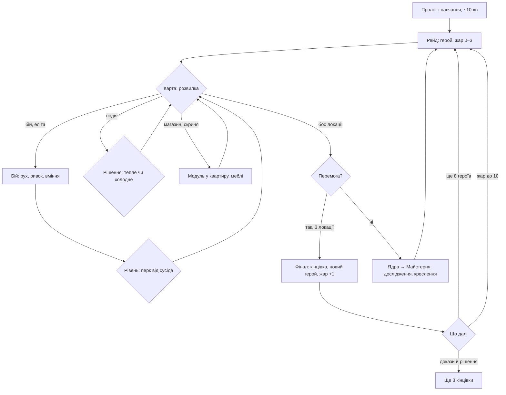

# Фінансова модель: скільки триває гра, як на ній заробити й хто в неї гратиме

Ментор попросив до захисту три речі: порахувати, за скільки проходиться гра без покупок; запропонувати монетизацію, за якої гра проходиться безкоштовно, а добровільна покупка лише прискорює; оцінити ринок і можливий прибуток. Тут усе це з числами. Монетизації в грі **немає** й до захисту не буде: це пропозиція, виміряна ботами.

## Коротко

| Що | Число | Звідки |
| --- | --- | --- |
| Перша кінцівка | 1–1,5 год | боти, медіана 2 рейди |
| Сюжет повністю (9 епілогів) | **7 год** уважно, **14 год** неуважно | боти, 6 профілів кожен |
| 100% (перемога на жарі 10) | **9 год** уважно; неуважний за 90 рейдів (~25 год) доходить у 2 з 6 | боти |
| По годині на день | сюжет за **1–2 тижні**, 100% за **1,5 тижня — місяць+** | те саме / 1 год |
| Будинок, що не рухається | **1 перемога на 160 рейдів** | бот idle |
| Найкорисніша покупка («Запасний генератор», 80 грн) | неуважному сюжет **14 → 10 год**, уважному 7 → 6 год | бот із покупкою |
| Найшвидше 100% з усіма покупками | 4,3 год уважному, 10,5 год неуважному; повне проходження за 1 год неможливе | бот з усіма покупками |
| Модель | безкоштовно, **без реклами**, без лутбоксів; разові покупки $1–3 | пропозиція |
| Дохід за рік (базовий сценарій) | ≈ **$1,8 тис.** чистими (після комісії магазину й витрат) при 30 тис. встановлень | розрахунок нижче |

Гра кооперативна: два гравці воюють разом проти машин. PvP немає, тож покупка ніде не дає переваги над іншою людиною.

## 1. Як міряли

`scripts/playtime.cjs` грає кар’єру з нового профілю тим самим кодом, що й гра: справжній `Battle` з `engine.ts` проводить кожен бій (30 кроків на секунду, секунди рахує сам рушій), а `model.ts` — карту, нагороди, магазин, події, кінець рейду й Майстерню між рейдами. Бот бере героя, яким ще не вигравав, і після кожної перемоги піднімає жар на 1, як людина, що хоче всього. Час на екранах поза боєм — оцінка, скільки людина читає й обирає (`OFF` у скрипті): мапа 10 с, нагорода 20 с, подія 35 с, магазин 45 с, нова локація зі сценою 60 с, кінець рейду з Майстернею 60 с.

Три «пілоти» (`scripts/pilots.cjs`):

- **reactive, уважний гравець**: тримає дистанцію, виходить із позначених зон до удару, ухиляється від куль, робить ривок, коли треба.
- **circle, неуважний**: ходить по колу, нічого не бачить, ривок і поштовх лише коли ворог впритул.
- **idle**: стоїть на місці, будинок лише стріляє сам.

Кожен пілот грає 6 профілів із різними зернами, до 90 рейдів (idle до 30). Відтворити:

```bash
npm test
MAX_RAIDS=90 node scripts/playtime.cjs reactive 6
MAX_RAIDS=90 node scripts/playtime.cjs circle 6
MAX_RAIDS=90 REVIVE=1 node scripts/playtime.cjs circle 6
```

Чесно про межі. Бот реагує миттєво, а людина ні, тож уважний бот — це швидкий гравець, а не середній. Бот не збирає докази навмисно, тому три з чотирьох кінцівок він не рахує (для них потрібні 6–10 доказів і рішення в подіях), і справжній сюжет довший за «9 епілогів». Час на екранах — оцінка. Справжній час людей поміряємо на плейтестах у грудні: профіль уже пише `playTime` (час у боях) і кількість рейдів.

## 2. Коридор гравця



Ключові точки, де гравець «повертає»: маршрут на карті (ризик проти нагороди), у яку квартиру ставити модуль (сусідство дає бонуси й еволюції зброї), який перк узяти, на що витратити ядра, який жар обрати, як відповісти в події (від цього залежить кінцівка «Загальні збори»), грати самому чи вдвох. Хоч би куди він повернув, коридор однаковий: поразки дають ядра, ядра роблять будинок сильнішим, перемога відкриває героя й наступний жар.

## 3. Скільки триває гра без покупок

Медіана по 6 профілях, у дужках найшвидший і найповільніший, далі кількість рейдів.

| Віха | Уважний (reactive) | Неуважний (circle) | Стоїть (idle) |
| --- | --- | --- | --- |
| Перша перемога, кінцівка «Протокол № 18» | 1,1 год (0,6–1,1), 2 рейди | 1,2 год (0,6–1,5), 2 рейди | 1 з 6 профілів за 30 рейдів |
| Усі 9 героїв (8 перемог) | 6,0 год (5,4–7,4), 11 рейдів | 12,2 год (5,2–13,9), 34 рейди | — |
| Перемога кожним героєм (9 епілогів) | 6,9 год (5,9–8,5), 13 рейдів | 14,4 год (5,7–15,2), 38 рейдів | — |
| Перемога на жарі 10 | 9,1 год (8,0–11,5), 17 рейдів, 6 з 6 | 2 з 6 профілів (7,3 і 11,7 год); решта не дійшла за 90 рейдів (22–25 год) | — |

Рейд із перемогою триває близько 35 хв, програний 14–25 хв.

### Два сценарії

| | Безперервно | По годині на день |
| --- | --- | --- |
| Перша кінцівка | 1–1,5 год | 1–2 дні |
| Сюжет, уважний | 7 год | **тиждень** |
| Сюжет, неуважний | 14 год | 2 тижні |
| 100%, уважний | 9 год | 9–10 днів |
| 100%, неуважний | 25+ год або ніколи | місяць+ |

**Чи можна пройти гру за один день?** Першу кінцівку так, і це задумано: як перша втеча в рогаликах, вона лише відкриває гру (нового героя, жар, ще три кінцівки). Повний сюжет найшвидший бот проходить за 6–7 год безперервної гри, тобто за довгий вихідний, а при годині на день навіть у найшвидшому сценарії це тиждень. Неуважний гравець іде вдвічі довше.

**Для порівняння з жанром** (дані Grouvee, середні за гравцями): Vampire Survivors — основна гра близько 24 год, 100% близько 39 год; Brotato — основна близько 10 год, 100% близько 51 год. Наш сюжет (7–14 год) на нижній межі жанру, 100% (9–25+ год) теж. Довшою гру роблять нові розділи, а не штучні таймери: таймерів очікування й «енергії» в грі немає й не буде.

## 4. Де скіл, якщо будинок стріляє сам

Гравець не цілиться, а **обирає місце**: будинок стріляє в найближчу ціль, а живе чи падає залежно від того, куди його поведуть. Що робить гравець у бою: рух (утікати від загону, тягнути ворогів у вузький прохід, ховатися за твердими предметами від куль), ривок, поштовх, вміння героя на E. Боси й мінібоси позначають зону до удару; хто вийде вчасно, не втрачає нічого. Між боями: маршрут, будова будинку, перки, жар.

Що це дає в числах (ті самі боти, той самий будинок, та сама Майстерня):

| | Стоїть | Неуважний | Уважний |
| --- | --- | --- | --- |
| Перемоги на жарі 0 | 1 зі 160 рейдів | 6 з 13 | 6 з 9 |
| Перемоги на жарі 10 | — | 2 зі 155 | 6 з 19 |
| Дійшли до жару 10 | — | 2 з 6 | 6 з 6 |

Тобто без руху гра не проходиться зовсім, а уважний гравець на найвищій складності виграє приблизно кожен третій рейд проти одного з вісімдесяти в неуважного.

Так було не завжди. Перший прогін показав, що гра надто легка: будинок, що стоїть, після кількох рейдів прокачування вигравав на жарі 0 (3 з 40), а неуважний бот вигравав перший же рейд. У 0.40.0 удари босів і мінібосів у позначених зонах б’ють у 1,6 раза сильніше (`LEADER_STRIKE` у `modes.ts`), а вороги 2-ї і 3-ї локацій стали міцнішими (`BASELINE`). Тепер стояти під ударом програшно, а прокачка не замінює уважності.

Де потрібна тактика, а не лише реакція: загони приходять трьома хвилями з передишками й ватажком, і передишку треба використати, щоб стати вигідно; стрільці цілять на випередження, тож від них не втечеш по прямій; посилені вороги мають властивості (санітар лікує загін, і його треба дістати першим; вибухового не підпускають впритул; подільник розпадається на менших); бос має другу фазу й вікно оглушення після важкої атаки; події в бою (кур’єр із посилкою, що тікає) змушують ризикувати заради нагороди. Далі можна додати локації з власним правилом (наприклад, де будинок стріляє лише стоячи), але й зараз гра без тактики не проходиться.

## 5. Монетизація: пропозиція

### Принципи

1. **Уся гра безкоштовна** й проходиться без грошей: усі герої, кінцівки, жар 10.
2. **Без реклами**, без лутбоксів, без «енергії» й таймерів. Реклама, що перебиває гру, це те, від чого гравці йдуть, і ментор прямо проти неї.
3. Покупки **разові, $1–3**, добровільні. Підписок немає.
4. **Скіл важливіший за гаманець.** Це виміряно (таблиця нижче). Там, де є змагання (рекорд денного забігу, досягнення «жар 10»), покупки не діють: рекорд ставиться без генератора, а досягнення з генератором позначається.
5. **Кооператив, не PvP.** Покупка діє лише на будинок покупця. Напарник нічого не втрачає, а від генератора друга навіть виграє: будинок, що підвівся, далі прикриває двір.

### Що продавати й що це змінює

Кожен варіант зіграли ті самі боти (`BONUS`, `REVIVE`, `HEAT_START` у `scripts/playtime.cjs`), щоб не гадати.

| Покупка | Ціна | Що дає | Уважний: сюжет / 100% | Неуважний: сюжет / 100% | Рішення |
| --- | --- | --- | --- | --- | --- |
| Без покупок | 0 | — | 6,9 / 9,1 год | 14,4 год / 2 з 6 | — |
| «Кава для ОСББ» | 40 грн (~$1) | +50% ядер після кожного рейду, кружка на фасаді | 6,7 / 10,7 год | 14,6 год / 2 з 6 | **продавати як подяку**: не прискорює, і ми так і кажемо |
| «Запасний генератор» | 80 грн (~$2) | раз за рейд будинок підводиться з половиною здоров’я | 6,3 / 8,8 год | **9,7 год / 5 з 6** (10,4 год) | **головна покупка**: прискорює тих, кому важко |
| «Пропуск жару» (разом з двома вище) | — | кар’єра з жару 5 замість 0 | 7,5 / **4,3 год** | сюжет закінчили лише 2 з 6 за 90 рейдів / 6 з 6 (10,5 год) | **не продавати** (див. нижче) |
| Розділ «Сусідній будинок» | 120–200 грн ($3–5) | нова локація, бос, 2 герої, розділ сюжету | ≈ +3–5 год (оцінка) | ≈ +3–5 год (оцінка) | після релізу: продовжує гру, а не скорочує |

Що з цього випливає:

- **Ресурси не купують перемог.** Півтора раза більше ядер не змінили нічого: прогрес у грі — це перемоги, а перемоги дає вміння. Тому «Кава» чесна подяка розробнику з дрібним бонусом, а не прискорення.
- **Генератор** — та «кава», про яку говорив ментор: неуважному гравцеві сюжет коротшає з 14 до 10 год (на 33%), а до жару 10 доходять 5 з 6 профілів замість 2. Уважному він майже не потрібен (−9%). Повне проходження за годину неможливе навіть із ним.
- **Скіл досі сильніший**: неуважний із генератором доходить до жару 10 за 10,4 год, з усіма трьома покупками за 10,5 год, а уважний без жодної покупки за 9,1 год.
- **Пропуск жару відкинуто.** Він удвічі скорочує шлях до 100% уважному гравцеві (9,1 → 4,3 год), а жар 10 і є звання вмілого гравця, тож продавати його означало б продавати звання. Неуважному він шкодить: бої на жарі 5+ важчі, і сюжет за 90 рейдів закінчили лише 2 профілі з 6 (без покупок усі 6). Виміряли й не беремо.
- Скіни ментор назвав класикою, якої не хотілося б, тож косметика лише в «Каві» (кружка на фасаді), без окремого магазину.

### Чому безкоштовно, а не за 40 грн

Ментор пропонував варіант «продати за 40 грн». Для кооперативної гри це гірше: щоб пограти вдвох, друг має встановити гру, і кожен платний вхід ріже запрошення. Безкоштовна гра з добровільною покупкою дає кожному гравцеві шанс привести другого, а платять ті, кому гра сподобалася.

## 6. Ринок і аудиторія

### Жанр доведений

Гра належить до «survivors-like»: будинок стріляє сам, гравець рухається й будує збірку між боями. Цей жанр за кілька років дав кілька інді-хітів, зроблених малими командами:

| Гра | Рік | Аудиторія | Джерело |
| --- | --- | --- | --- |
| Vampire Survivors | 2022 | ~27 млн гравців на всіх платформах, ~6 млн власників у Steam (оцінка) | levvvel.com, steampageanalyzer.com |
| Brotato | 2023 | ~5,8 млн проданих у Steam і ~$17,8 млн валового доходу (оцінка); 10+ млн на всіх платформах | steamdata.ai, Wikipedia |
| Megabonk | 2025 | 1 млн копій за 2 тижні; ~2,7 млн (оцінка) | PC Gamer, Game World Observer, raijin.gg |
| Deep Rock Galactic: Survivor | 2024–25 | понад 1 млн проданих | PC Gamer |

Brotato зробила одна людина, Vampire Survivors починала теж. Тобто ринок відкритий для малих команд, якщо гра має свою ідею. Наша ідея: керуєш будинком і його мешканцями, сюжет і гумор про ОСББ, гра вдвох на телефонах.

### Наш ринок

Ментор написав «наш ринок — усе СНГ». Ми свідомо **не** йдемо на ринки Росії й Білорусі: гра українською, про українське ОСББ, і заробляти там ми не хочемо. Наш ринок — Україна й українська діаспора, далі Польща, Балтія й англомовні гравці з англійською локалізацією.

| | Хто | Оцінка |
| --- | --- | --- |
| TAM, увесь ринок жанру | гравці survivors-like у світі | десятки мільйонів (лише Vampire Survivors ~27 млн) |
| SAM, досяжний | українськомовні гравці з телефоном або ПК | ≈ 30 млн людей в Україні (оцінка, перепису після 2022 немає) × 22% тих, хто грає щодня ≈ **6–7 млн** |
| SOM, реальна частка за рік | ті, хто встановить | 5–150 тис. (0,1–2% SAM), залежно від сценарію нижче |

Гравці Східної Європи витрачають на ігри в середньому ~$51,6 на рік (WN Hub через Межу), тож $1–3 добровільно — малий поріг.

### Скільки це може заробити за перший рік

| | Обережний | Базовий | Оптимістичний |
| --- | --- | --- | --- |
| Що робимо | Google Play + веб, лише Україна, без бюджету на рекламу | + англійська локалізація, itch.io, сарафан і короткі відео | + Steam, польська мова, вихід у добірки магазинів |
| Встановлень | 5 000 | 30 000 | 150 000 |
| Хто платить | 2% → 100 | 3% → 900 | 4% → 6 000 |
| Середній чек | $2 | $2,5 | $3 |
| Валовий дохід | $200 | $2 250 | $18 000 |
| Після комісії магазину (15%) | $170 | $1 910 | $15 300 |
| Витрати за рік | $85 | $85 | $185 |
| **Чистими** | **≈ $85** | **≈ $1 800** | **≈ $15 100** |

Звідки числа. Частка тих, хто платить у безкоштовних мобільних іграх, зазвичай 1–5% (AppFollow, Playio). Середній чек — з нашого прайсу ($1–3, хтось бере обидві покупки). Google Play бере 15% з першого мільйона доходу на рік (Game Developer, TechCrunch). Витрати: акаунт розробника Google Play $25 разово; власний релей для гри по мережі замість публічних брокерів ≈ $5 на місяць (найдешевший VPS), $60 на рік; Steam Direct $100 за гру (повертається після $1 000 доходу). Музика синтезується кодом, малюнки й голоси вже зроблені, тож прямих витрат на контент немає; головна вкладена ціна — робочий час автора.

Висновок: навіть обережний сценарій окупає витрати, базовий дає ~$1,8 тис. за рік без реклами й без жодного тиску на гравця. Головна змінна — встановлення, тобто англійська локалізація й короткі відео з кооперативом. Покупки, що прискорюють проходження вдвічі, ми свідомо не продаємо.

### Що це дає, крім грошей

- Українськомовна гра з українським гумором і сеттингом, де кожна репліка озвучена: такого контенту мало.
- Працює без інтернету й на слабких телефонах (адаптивна якість, «ощадний» режим у 0.40.0), без облікових записів, реклами й збору даних.
- Гра вдвох на телефонах: привід пограти з другом, а не наодинці.

## 7. Що далі

1. **Грудневі плейтести**: 5–10 людей, з профілю знімаємо `playTime`, кількість рейдів і перемог. Порівнюємо з ботами й уточнюємо час на екранах (`OFF`) і таблицю розділу 3.
2. Якщо люди проходять сюжет швидше за 5 год або повільніше за 25, правимо `BASELINE` і `LEADER_STRIKE` і повторюємо прогін.
3. Монетизацію робити лише після релізу в Google Play: генератор вимикається в денному забігу, позначка на досягненні «жар 10».

## Джерела

- Vampire Survivors: [levvvel.com](https://levvvel.com/vampire-survivors-statistics/), [steampageanalyzer.com](https://www.steampageanalyzer.com/games/1794680); тривалість: [grouvee.com](https://www.grouvee.com/games/90450-vampire-survivors/)
- Brotato: [steamdata.ai](https://steamdata.ai/game/1942280), [raijin.gg](https://raijin.gg/app/1942280/Brotato), [Wikipedia](https://en.wikipedia.org/wiki/Brotato); тривалість: [grouvee.com](https://www.grouvee.com/games/93299-brotato/)
- Megabonk: [PC Gamer](https://www.pcgamer.com/games/roguelike/vampire-survivors-like-megabonk-makes-megabucks-selling-a-million-copies-in-2-weeks-and-currently-has-more-daily-players-than-borderlands-4-on-steam-ill-be-eating-spaghetti-with-extra-sauce-tonight), [Game World Observer](https://gameworldobserver.com/2025/10/03/megabonk-is-a-new-indie-hit-on-steam-the-games-sales-have-surpassed-one-million-copies), [raijin.gg](https://raijin.gg/app/3405340/Megabonk)
- Deep Rock Galactic: Survivor: [PC Gamer](https://pcgamer.com/games/roguelike/deep-rock-galactic-survivor-sails-past-a-million-sold-as-developers-salute-players-ravenous-appetite-for-space-dwarf-content)
- Частка платників і ARPPU: [AppFollow](https://appfollow.io/blog/mobile-game-kpis), [Playio](https://blog.playio.co/arppu-mobile-games)
- Комісія Google Play 15%: [Game Developer](https://www.gamedeveloper.com/game-platforms/google-play-halves-its-fee-to-15-for-devs-first-1m-revenue-per-year), [TechCrunch](https://techcrunch.com/2021/03/16/google-play-drops-commissions-to-15-from-30-following-apples-move-last-year/)
- Гравці в Україні (22% щодня): [НВ Бізнес](https://biz.nv.ua/ukr/experts/geyming-v-ukrajini-zrostannya-auditoriji-y-pributkiv-zmina-cifrovih-spilnot-50557551.html)
- Витрати гравців у Європі: [Межа](https://mezha.ua/news/european-gamers-donate-less-304009/amp/)
